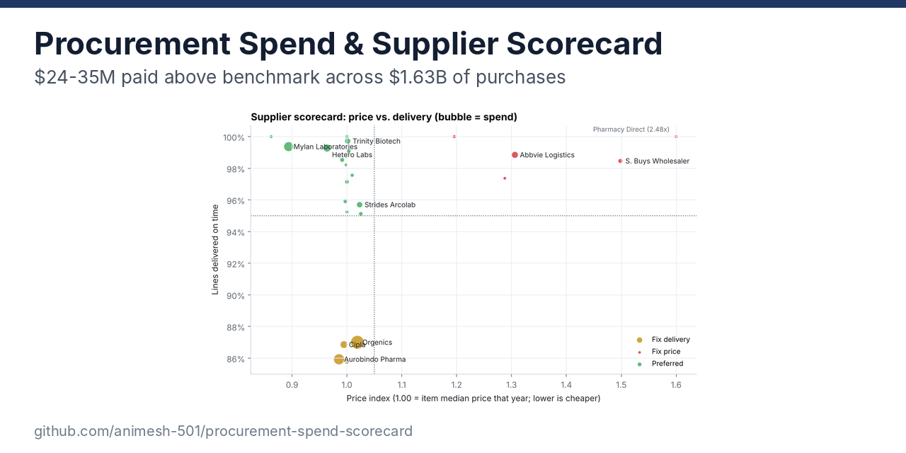
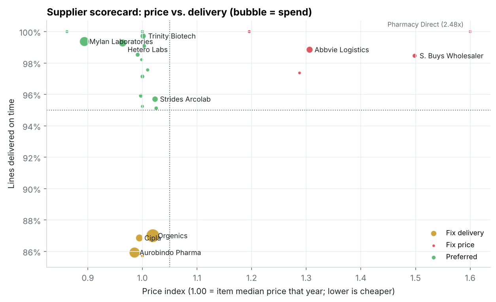
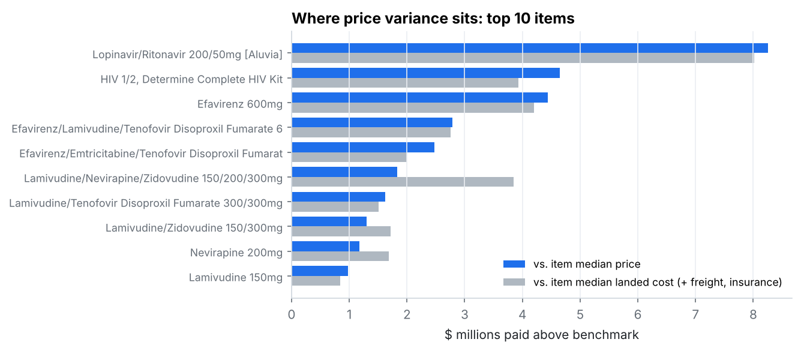
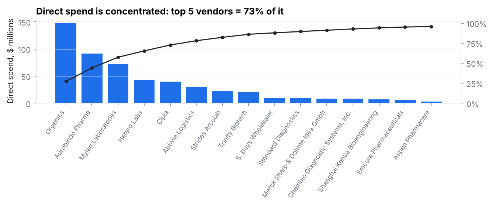
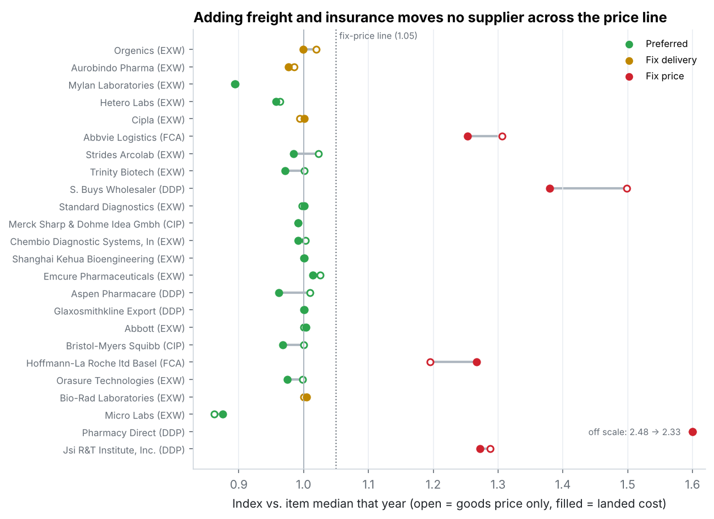
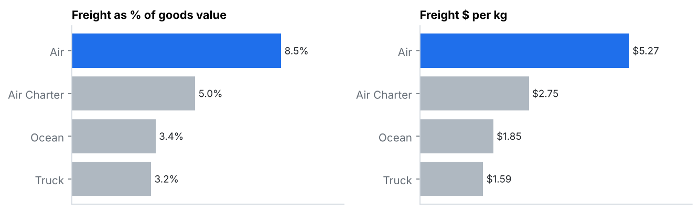
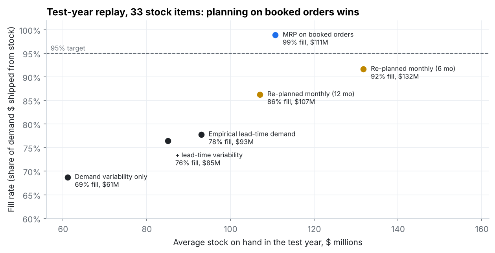

# Procurement Spend Analysis & Supplier Scorecard

**Where is money leaking, and which suppliers need attention?** This project analyzes $1.63B of purchases (10,324 purchase lines, 72 vendors, 2006–2015). It benchmarks every price against what the same item cost from other purchases, and scores each major supplier on price and delivery. A second part builds a [Plan for Every Part](pfep/README.md) with MRP planning from the same lines.



`SQL (DuckDB)` `Python` `pandas` `SciPy` `matplotlib`

---

## Summary

| | |
|---|---|
| **Price variance** | **$35–38M** paid above each item's median that year: $35M on goods price, $38M on landed cost with freight and insurance (2.2–2.3% of spend) |
| **Where it sits** | 5 vendors with 8% of scorecard spend account for **$11.5M**, a third of it |
| **Delivery risk** | The 2 largest suppliers (44% of direct spend) delivered only **86–87%** of lines on time |
| **Concentration** | Top 5 vendors = **73%** of direct spend |
| **Benchmark supplier** | Mylan: **11% below** median price *and* 99.4% on time, on $72M of spend |
| **Planning (PFEP)** | 33 items carry 98% of spend and need stock. In a replay of the following year, planning on booked country orders shipped **99%** of demand from stock, against 69–78% with fixed safety stock ([details](#plan-for-every-part)) |



**Recommendations**
1. **Renegotiate the five "Fix price" vendors first.** AbbVie Logistics (31% above benchmark, $7.6M excess) and S. Buys Wholesaler (50% above, $3.2M) are the big two. Their delivery is fine, so price is the only conversation.
2. **Put the "Fix delivery" vendors on a delivery performance plan.** Orgenics, Aurobindo and Cipla price at or near the median, but 13–14% of their lines arrive late. Aurobindo and Cipla average 36 and 41 days late when they miss. With 52% of scorecard spend between them, this is the biggest service risk.
3. **Use Mylan's terms as the reference when negotiating.** It's the only large supplier that is both cheaper than benchmark and reliably on time.
4. **Benchmark on landed cost.** Adding freight and insurance raises the total to $38M, and every supplier stays in the same tier. The price conversations above still hold once delivery costs are counted. An earlier benchmark that compared only purchases under the same delivery terms gave $24M. Most of that drop came from how it was built, so I've stopped using it as a floor (see [Landed cost](#landed-cost)).

---

## Price variance

Every purchase line is compared to the median pack price paid for **the same item in the same year**. This uses only items bought at least 5 times that year, which covers 98% of spend. "Excess" is what was paid above that median, which is the saving if every above-median purchase had been made at the median.



| Benchmark | Excess paid | % of spend compared |
|---|---|---|
| Item median price, same year | $35.2M | 2.2% |
| Item median **landed cost** (goods + freight + insurance), same year | $38.0M | 2.3% |
| Item median price, same year and same delivery terms (retired, see below) | $24.3M | 1.5% |

The biggest item is Lopinavir/Ritonavir at $8.3M on price and $8.0M landed. Purchases from AbbVie under FCA cost about $61 a pack in 2013–2015, while the landed median was $20–25 and freight added about $1 a pack. Delivery terms don't explain that gap.

---

## Supplier scorecard

24 vendors with 20+ direct deliveries, covering 98% of direct spend. I used explicit thresholds instead of a weighted composite score, so each tier says what's wrong:

| Tier | Rule | Vendors | Share of spend | Excess paid |
|---|---|---|---|---|
| Preferred | price index ≤ 1.05 and ≥ 95% on time | 15 | 40% | $2.6M |
| Fix delivery | under 95% on time | 4 | 52% | $6.9M |
| Fix price | price index > 1.05 | 5 | 8% | $11.5M |

**Price index** = what the vendor charged ÷ what the same items would have cost at benchmark. 1.10 means 10% above. Full scorecard with lead times and freight in [`outputs/supplier_scorecard.csv`](outputs/supplier_scorecard.csv).



---

## Landed cost

The price index compares goods prices only. Under EXW and FCA the buyer pays freight on top, while under DDP and CIP the supplier delivers and the freight is in the price. So I rebuilt every line as **goods + freight + insurance** and re-ran the same benchmark (item median, same year) on landed cost per pack.

Freight and insurance add **$72.6M, 4.5% of goods value**. The source file records freight four ways, and each needs its own rule:

| Freight entry | Lines | How it's handled |
|---|---|---|
| A number | 6,198 | Used as is |
| "See ASN-… (ID#:n)" | 2,340 | The shipment's freight sits on line n. It's shared across every line in that shipment by line value ($10.3M) |
| "Freight Included in Commodity Cost" | 1,442 | Zero extra. Most of these (1,123) are DDP lines, which fits the terms |
| "Invoiced Separately", or a pointer to such a line | 344 | Estimated at the freight rate of lines with the same shipment mode and terms. This is $1.4M, 1.9% of all freight |

Insurance is a number on 97% of lines; the rest use that year's median rate.



**No supplier changes tier.** The five "Fix price" vendors are still above 1.05 on landed cost, and they still account for $11.1M of excess.

- AbbVie drops from 1.31 to 1.25 and S. Buys from 1.50 to 1.38, because the benchmark now includes the freight paid on top for other suppliers' lines.
- Roche gets worse, going from 1.20 to 1.27. It sells FCA, so the buyer pays its freight.
- Strides goes from 1.02 to 0.99 and Orgenics from 1.02 to 1.00. Both look cheaper on a delivered basis.

Some DDP and CIP lines also carry a freight number, which could be the supplier's cost passed through. Re-running with freight set to zero on every seller-paid term gives $37.4M, and again no tier changes.

**Why I retired the same-terms benchmark.** It came out $10.9M below the plain item benchmark, and the README used to put that down to freight. Splitting the gap by cause ([`outputs/same_terms_gap.csv`](outputs/same_terms_gap.csv)) shows most of it is built into the method:

| Cause of the gap | Gap | Share |
|---|---|---|
| Only one supplier bought on those terms, so its own price became the benchmark | $5.4M | 49% |
| Under 5 purchases on those terms, so there's no benchmark and the line counts as zero | $3.6M | 33% |
| Two or more suppliers on the same terms (a fair comparison) | $1.9M | 17% |

Landed cost handles delivery terms directly, by adding the freight each line actually carried. Vendor detail is in [`outputs/landed_cost_by_vendor.csv`](outputs/landed_cost_by_vendor.csv).

---

## Freight



Air carries 59% of lines, and its freight costs 8.5% of goods value versus 3.2–3.4% for truck and ocean. Per kg it's about 3x ocean. Air was also more often on time (90% vs 83% for ocean), so shifting modes trades cost for reliability. That trade-off is worth testing on non-urgent replenishment orders.

---

## Plan for Every Part

The spend analysis looks back at what was paid. [`pfep/`](pfep/README.md) uses the same purchase lines to plan forward. Every item gets a row with its supplier, measured lead time, usage, pack size, weight, stock rule and order-up-to level ([`pfep/outputs/pfep.csv`](pfep/outputs/pfep.csv)). The policies are set on Sep 2012 to Aug 2014 and replayed on the next 12 months of actual demand.

- **Lead time** from PO to delivery has a median of 109 days and a typical spread of ±68 days. Counting that spread adds 42% to safety stock ($66M to $94M).
- **Fixed safety stock reached 69–78% fill.** One item doubled and was 42% of test-year demand value; without it the lead-time-aware methods reach about 95%.
- **Most demand is booked well ahead.** Quotes go to countries a median of 184 days before delivery, so 94% of demand 3 months out is already known.
- **MRP on booked orders reached 99% fill** on $111M of average stock. Re-planning monthly on a 6-month average reached 92% on $132M. Booked quantities are final delivered quantities, so 99% is an upper bound.



---

## Definitions & limits

- **Spend** = line item value (goods only, excluding freight and insurance). **Landed cost** = goods + freight + insurance.
- **On time** = delivered on or before the scheduled delivery date.
- **Direct vs. warehouse:** 52% of lines ship from regional warehouses. Those are internal transfers with no external vendor, so the scorecard covers direct purchases only. Warehouse lines were on time 83% of the time versus 95% for direct, which is worth its own look.
- Freight is a number on 60% of lines. The rest say "included in commodity cost", "invoiced separately" or point to another shipment. The freight-by-mode figures use numeric lines only. Landed cost uses the rules in [Landed cost](#landed-cost), and only "invoiced separately" lines are estimated.
- Price differences can also reflect order size, shelf life or urgency, which the data doesn't capture. Treat the excess as a starting point for negotiation.

---

## How to run

```bash
pip install -r requirements.txt
python run_all.py          # spend analysis and supplier scorecard
python pfep/run_all.py     # Plan for Every Part and MRP replay
```

The source file is included in `data/raw/` (public US government data, [source](data/README.md)). A full run takes a few seconds; console output is in [`outputs/run_log.txt`](outputs/run_log.txt).

```
sql/
  01_quality_checks.sql      duplicates, value = qty x price, text in numeric fields
  02_clean_lines.sql         parsed dates, numeric freight, on-time flag, lead time
  03_spend.sql               spend by year and channel, vendor pareto
  04_price_variance.sql      item-year median benchmarks, excess per line and per item
  05_vendor_scorecard.sql    price index, on-time, lead time, freight per vendor; freight by mode
  06_landed_cost.sql         freight and insurance per line, landed benchmark, landed index per vendor
src/
  data.py                    loads the CSV into DuckDB, runs the SQL
  scorecard.py               tier rules
  landed.py                  landed vs price index, benchmark comparison, same-terms gap
  charts.py
outputs/
  summary.csv  supplier_scorecard.csv  scorecard_tiers.csv  item_opportunity.csv
  vendor_pareto.csv  spend_by_year.csv  freight_by_mode.csv  price_variance_by_line.csv
  landed_cost_by_vendor.csv  benchmark_comparison.csv  same_terms_gap.csv
pfep/                        Plan for Every Part and MRP (own SQL, src, outputs, charts; see pfep/README.md)
```
