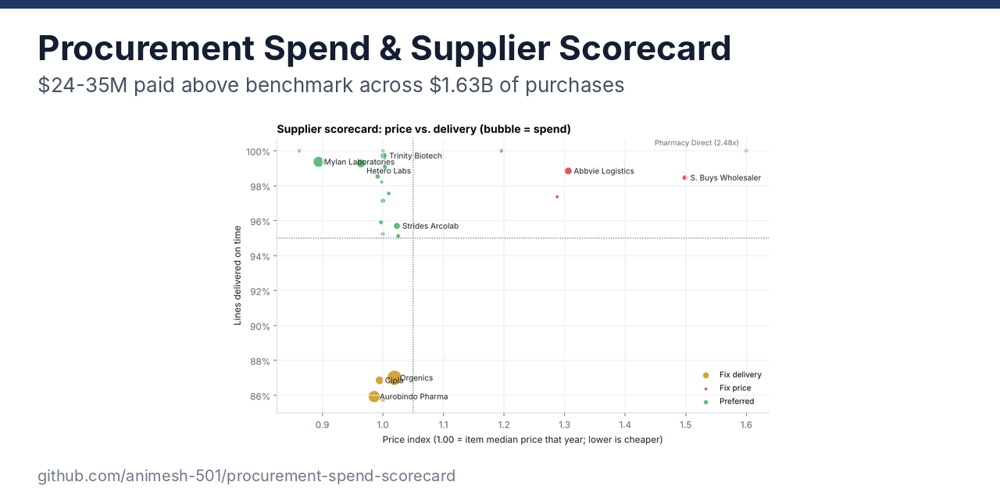
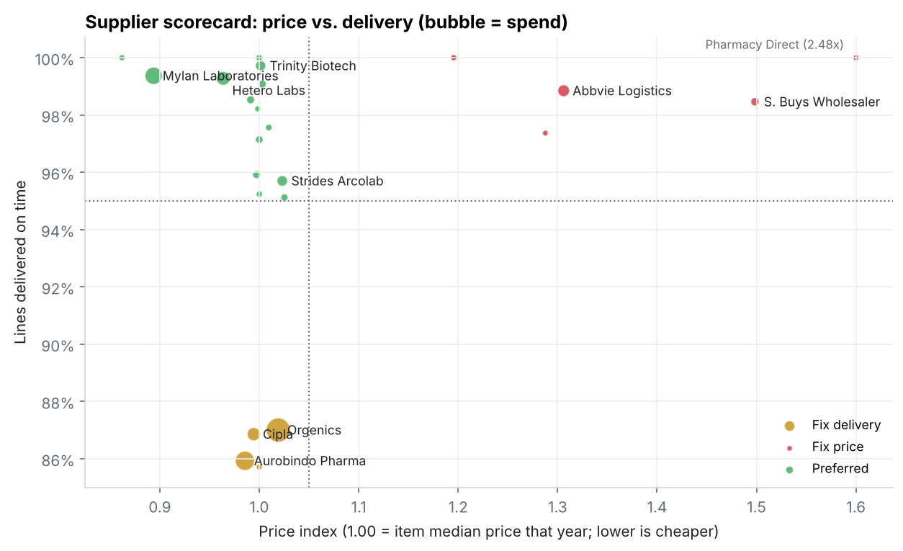
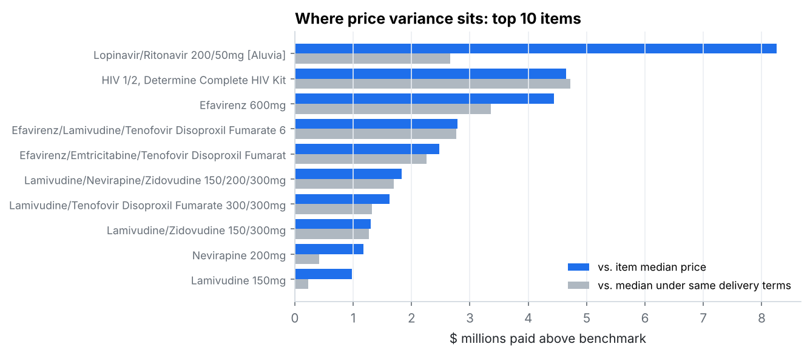
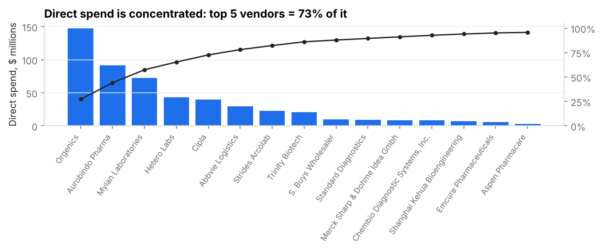
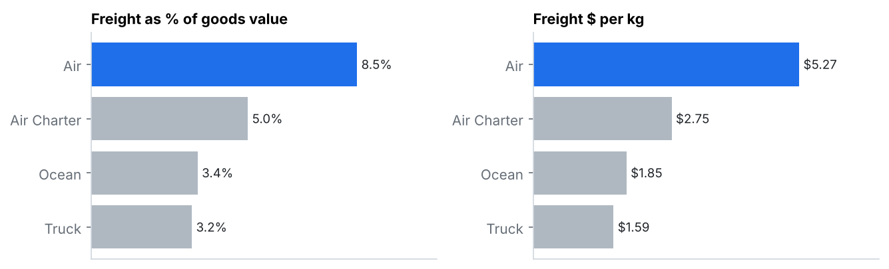

# Procurement Spend Analysis & Supplier Scorecard

**Where is money leaking, and which suppliers need attention?** This project analyzes $1.63B of purchases (10,324 purchase lines, 72 vendors, 2006–2015). It benchmarks every price against what the same item cost from other purchases, and scores each major supplier on price and delivery.



`SQL (DuckDB)` `Python` `pandas` `matplotlib`

---

## Summary

| | |
|---|---|
| **Price variance** | **$24–35M** paid above each item's median price (1.5–2.2% of spend) |
| **Where it sits** | 5 vendors with 8% of scorecard spend account for **$11.5M**, a third of it |
| **Delivery risk** | The 2 largest suppliers (44% of direct spend) delivered only **86–87%** of lines on time |
| **Concentration** | Top 5 vendors = **73%** of direct spend |
| **Benchmark supplier** | Mylan: **11% below** median price *and* 99.4% on time, on $72M of spend |



**Recommendations**
1. **Renegotiate the five "Fix price" vendors first.** AbbVie Logistics (31% above benchmark, $7.6M excess) and S. Buys Wholesaler (50% above, $3.2M) are the big two. Their delivery is fine, so price is the only conversation.
2. **Put the "Fix delivery" vendors on a delivery performance plan.** Orgenics, Aurobindo and Cipla price at or near the median, but 13–14% of their lines arrive late. Aurobindo and Cipla average 36 and 41 days late when they miss. With 52% of scorecard spend between them, this is the biggest service risk.
3. **Use Mylan's terms as the reference when negotiating.** It's the only large supplier that is both cheaper than benchmark and reliably on time.
4. **Check the delivery terms before chasing every price gap.** About a third of the headline variance disappears when purchases are compared only against others under the same delivery (INCO) terms, because delivered prices include freight. The $24M figure is the defensible floor.

---

## Price variance

Every purchase line is compared to the median pack price paid for **the same item in the same year**. This uses only items bought at least 5 times that year, which covers 98% of spend. "Excess" is what was paid above that median, which is the saving if every above-median purchase had been made at the median.



| Benchmark | Excess paid | % of benchmarked spend |
|---|---|---|
| Item median price, same year | $35.2M | 2.2% |
| Item median price, same year **and same delivery terms** | $24.3M | 1.5% |

The biggest gap between the two benchmarks is Lopinavir/Ritonavir: $8.3M versus $2.7M. Most of its variance is the difference between ex-works and delivered pricing, not overpaying.

---

## Supplier scorecard

24 vendors with 20+ direct deliveries, covering 98% of direct spend. I used explicit thresholds instead of a weighted composite score, so each tier says what's wrong:

| Tier | Rule | Vendors | Share of spend | Excess paid |
|---|---|---|---|---|
| Preferred | price index ≤ 1.05 and ≥ 95% on time | 15 | 40% | $2.6M |
| Fix delivery | under 95% on time | 4 | 52% | $6.9M |
| Fix price | price index > 1.05 | 5 | 8% | $11.5M |

**Price index** = what the vendor charged ÷ what the same items would have cost at benchmark. 1.10 means 10% above. Full scorecard with lead times and freight in [`outputs/supplier_scorecard.csv`](outputs/supplier_scorecard.csv).



---

## Freight



Air carries 59% of lines, and its freight costs 8.5% of goods value versus 3.2–3.4% for truck and ocean. Per kg it's about 3x ocean. Air was also more often on time (90% vs 83% for ocean), so shifting modes trades cost for reliability. That trade-off is worth testing on non-urgent replenishment orders.

---

## Definitions & limits

- **Spend** = line item value (goods only, excluding freight and insurance).
- **On time** = delivered on or before the scheduled delivery date.
- **Direct vs. warehouse:** 52% of lines ship from regional warehouses. Those are internal transfers with no external vendor, so the scorecard covers direct purchases only. Warehouse lines were on time 83% of the time versus 95% for direct, which is worth its own look.
- Freight is a number on 60% of lines. The rest say "included in commodity cost", "invoiced separately" or point to another shipment, and are excluded from freight figures rather than guessed.
- Price differences can also reflect order size, shelf life or urgency, which the data doesn't capture. Treat the excess as a starting point for negotiation.

---

## How to run

```bash
pip install -r requirements.txt
python run_all.py
```

The source file is included in `data/raw/` (public US government data, [source](data/README.md)). A full run takes a few seconds; console output is in [`outputs/run_log.txt`](outputs/run_log.txt).

```
sql/
  01_quality_checks.sql      duplicates, value = qty x price, text in numeric fields
  02_clean_lines.sql         parsed dates, numeric freight, on-time flag, lead time
  03_spend.sql               spend by year and channel, vendor pareto
  04_price_variance.sql      item-year median benchmarks, excess per line and per item
  05_vendor_scorecard.sql    price index, on-time, lead time, freight per vendor; freight by mode
src/
  data.py                    loads the CSV into DuckDB, runs the SQL
  scorecard.py               tier rules
  charts.py
outputs/
  summary.csv  supplier_scorecard.csv  scorecard_tiers.csv  item_opportunity.csv
  vendor_pareto.csv  spend_by_year.csv  freight_by_mode.csv  price_variance_by_line.csv
```
