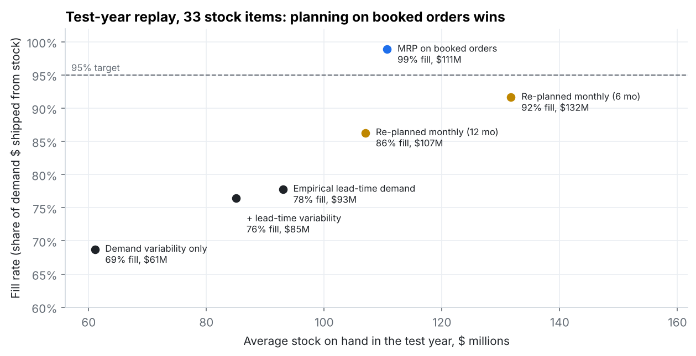
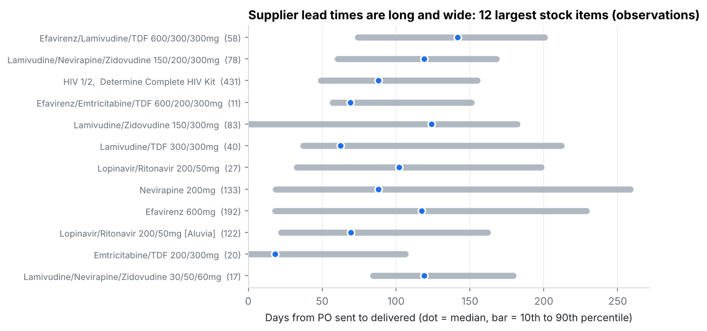
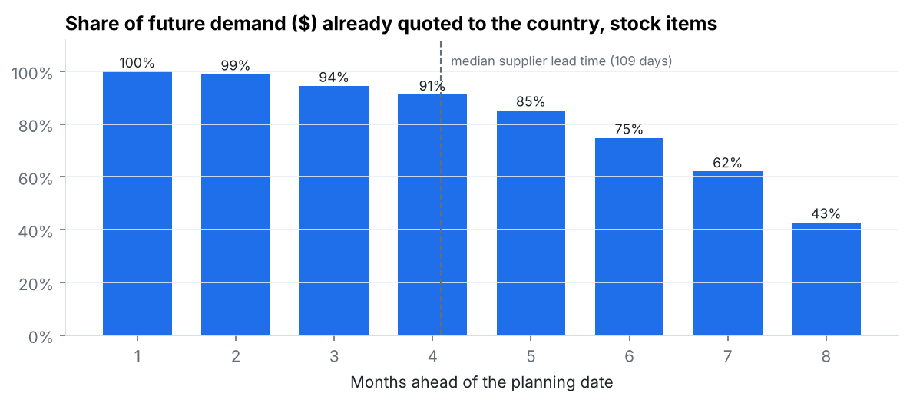
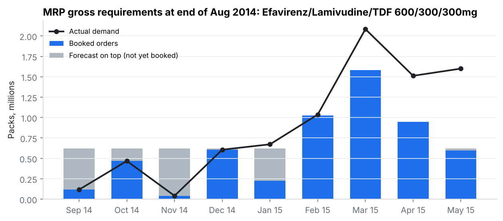

# Plan for Every Part (PFEP) & MRP

[← Back to the spend analysis and supplier scorecard](../README.md)

**For each of 184 purchased items: should we stock it, how much buffer does it need, and when do we order?** This part of the repo turns the same 10,324 purchase lines into a Plan for Every Part. Each item gets its supplier, measured lead time, usage, pack size, weight, stock rule and order-up-to level. The policies are then replayed on the year of demand that followed.

`SQL (DuckDB)` `Python` `pandas` `NumPy` `SciPy` `matplotlib`

---

## Summary

| | |
|---|---|
| **Stock rule** | **33 items** carry **98%** of spend and get a monthly-review stock policy. 72 low-volume items are bought to order, and 79 had no demand in the last two years |
| **Lead time** | PO to delivery takes a median **109 days**, with a typical spread of ±68 days (CV 0.6). Counting that spread raises safety stock by **42%**, from $66M to $94M |
| **Test-year replay** | Fixed safety stock reached only **69–78%** fill. Most of the miss is one item whose demand doubled, at 42% of test-year value |
| **Booked orders** | When each month is planned, **94%** of demand 3 months out has already been quoted to the country, and **85%** at 5 months |
| **MRP on booked orders** | Netting booked orders and forecasting only the rest gave **99% fill** on $111M of average stock. Re-planning on a 6-month average gave 92% on $132M |



**Recommendations**
1. **Plan the stock items with MRP on booked orders.** Use quoted country orders as gross requirements inside the lead time and forecast only what isn't booked yet. That's the only policy here that reached the 95% target.
2. **Size the buffer on lead-time spread.** Once demand inside the lead time is mostly known, the remaining risk is a supplier delivering late. The buffer becomes forecast × z × lead-time spread in months.
3. **Re-plan the parameters monthly and flag regimen changes.** A 24-month average missed the item that doubled. Any item whose last 6 months run well above or below its planning rate needs review before the next order.
4. **Keep the 72 buy-to-order items off the shelf.** Together they were 2.2% of spend, with demand in fewer than half the months.

---

## Plan for Every Part

One row per item in [`outputs/pfep.csv`](outputs/pfep.csv). Descriptive fields come from the full history (`sql/04_item_master.sql`). Planning fields come from the 24-month fit window, Sep 2012 to Aug 2014.

| Group | Fields |
|---|---|
| Part | product group, class, dosage form, units per pack, kg per pack (from lines with a numeric weight) |
| Supply | main vendor and its share of direct spend, number of vendors and manufacturing sites, main Incoterm and shipment mode, on-time rate |
| Usage | fit-window spend, ABC class, months with demand, monthly mean, SD and CV, pack price |
| Lead time | observations, median, mean, SD, 90th percentile, CV, and source (item, main vendor or product group) |
| Policy | stock decision, protection period, cycle stock, safety stock by three methods, order-up-to level |

**Stock rule:** stock an item if it had demand in at least 12 of the 24 fit months. That's 33 items: 8 A, 9 B and 16 C.

**Lead time** is PO sent to vendor → delivered to client, from direct lines (4,587 usable, 5 with negative values dropped). 28 stock items have 10+ observations of their own, and 5 use their main vendor's history.



---

## Safety stock: three ways

Policy: review monthly, then order up to S. Protection period = lead time + 1 review month. Target = 95% chance of no stock-out per cycle.

| Method | Formula | Safety stock, 33 items |
|---|---|---|
| Demand variability only | z × σ<sub>month</sub> × √P | $66.5M |
| + lead-time variability | z × √(P σ<sub>month</sub>² + d² σ<sub>P</sub>²) | $94.2M (+42%) |
| Empirical lead-time demand | 95th percentile of 20,000 draws: an observed lead time, then that many fit months of demand | $103.2M |

The empirical method lands above the formula because monthly demand is lumpy (median CV 1.3). Big country orders make the right tail heavier than a normal curve.

---

## Test-year replay

Every policy is replayed on the 12 months that followed (Sep 2014 to Aug 2015), using the demand that actually happened. Each order's lead time is drawn from that item's observed lead times, with 500 runs per item. The last 12 fit months warm the system up, and shortages are back-ordered. Results are in [`outputs/replay_summary.csv`](outputs/replay_summary.csv) and by item in [`outputs/replay_by_item.csv`](outputs/replay_by_item.csv).

| Policy | Fill rate | Fill rate without the largest item | Avg stock | Items under 90% fill |
|---|---|---|---|---|
| Demand variability only | 69% | 88% | $61M | 9 |
| + lead-time variability | 76% | 95% | $85M | 7 |
| Empirical lead-time demand | 78% | 96% | $93M | 5 |
| Re-planned monthly on last 12 months | 86% | 94% | $107M | 7 |
| Re-planned monthly on last 6 months | 92% | 96% | $132M | 7 |
| **MRP on booked orders** | **99%** | **99%** | **$111M** | **1** |

Fill rate = share of demand value shipped from stock in the month it was due.

**One item drives the gap.** Efavirenz/Lamivudine/TDF 600/300/300mg was 42% of test-year demand value, and it ran at 1.96× its fit-window rate. That fits countries moving to the once-daily first-line regimen WHO recommended in 2013. With fixed parameters it gets 42–53% fill whatever the safety stock method. Re-planning monthly lifts it to 75–86%, and booked orders to 99%. On the other 32 items, the lead-time-aware formulas already reach about 95%.

**Lead times hold up out of sample.** Re-running the replay with lead times drawn from POs actually sent during the replay window moves every fill rate by under 1.2 points ([`outputs/replay_lead_time_sensitivity.csv`](outputs/replay_lead_time_sensitivity.csv)).

---

## Booked orders and MRP

Each line's price quote goes to the country a median of **184 days** before delivery. The supplier lead time is 109 days. So at any month-end most of the demand inside the lead time is already known:



`src/mrp.py` plans the way MRP does. Gross requirement for each future month = the larger of booked orders and the forecast (forecast consumption). The forecast is the trailing 12-month average. The order-up-to level covers those requirements over the mean protection period, plus a buffer of z × forecast × σ<sub>P</sub> for late deliveries only.

A time-phased record for the three largest items at the end of Aug 2014 is in [`outputs/mrp_records.csv`](outputs/mrp_records.csv): booked orders, forecast, gross and net requirements, planned receipts and planned releases offset by lead time. The largest item:



Booked orders match actual demand exactly for the first 4 months. From month 5 on, booked orders cover only part of demand, and the flat forecast falls behind the growth. Re-planning each month picks that up as new quotes arrive.

---

## Definitions & limits

- **Demand** = packs delivered to countries per month, direct or from a regional warehouse. It's the demand a central planner covers. The data has no country stock levels or consumption.
- **Booked** = lines whose quote was sent by the planning date, at their final delivered quantity. Real quotes can change before delivery, so the booked-order result is an upper bound on what this visibility is worth.
- **Lead time** comes from direct lines only. Warehouse lines ship from stock and have no PO date, so warehouse items use the same suppliers' direct lead times.
- **Starting stock** isn't in the data. The replay starts each item at its order-up-to level and runs 12 warm-up months before measuring. The MRP record assumes on-hand = safety stock and open orders that cover each month inside the lead time. Both assumptions are labelled in the code.
- **Costs:** no holding or ordering costs are given, so stock is compared in dollars at the fit-window median pack price. Lot sizing is lot-for-lot with a monthly review.

---

## How to run

From the repo root:

```bash
pip install -r requirements.txt
python pfep/run_all.py
```

It reads the same source file as the spend analysis, `data/raw/` at the repo root ([source](../data/README.md)). A full run takes about 10 seconds and is reproducible (fixed seed); console output is in [`outputs/run_log.txt`](outputs/run_log.txt).

```
pfep/
  run_all.py
  sql/
    01_clean_lines.sql         parsed dates, delivery month, supplier lead time per direct line
    02_quality_checks.sql      negative lead times, missing quote dates
    03_monthly_demand.sql      packs per item per month, any route
    04_item_master.sql         descriptive PFEP fields per item
  src/
    data.py                    loads the CSV into DuckDB, runs the SQL
    policy.py                  stock rule, ABC, lead-time source, three safety stock methods
    replay.py                  test-year replay (fixed, re-planned and booked-order policies)
    mrp.py                     booked-order matrix, visibility, MRP levels and time-phased record
    charts.py
  outputs/
    pfep.csv  replay_summary.csv  replay_by_item.csv  replay_lead_time_sensitivity.csv
    order_visibility.csv  mrp_records.csv  summary.csv
```
